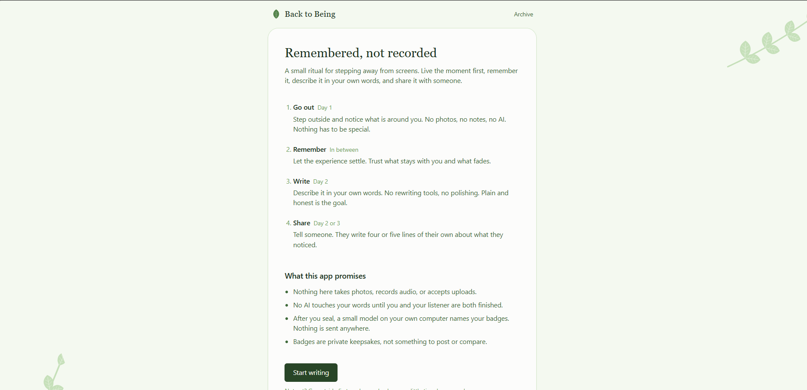
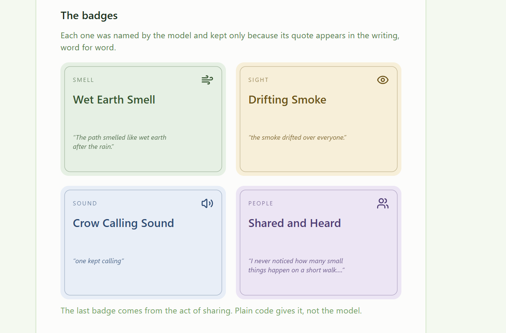
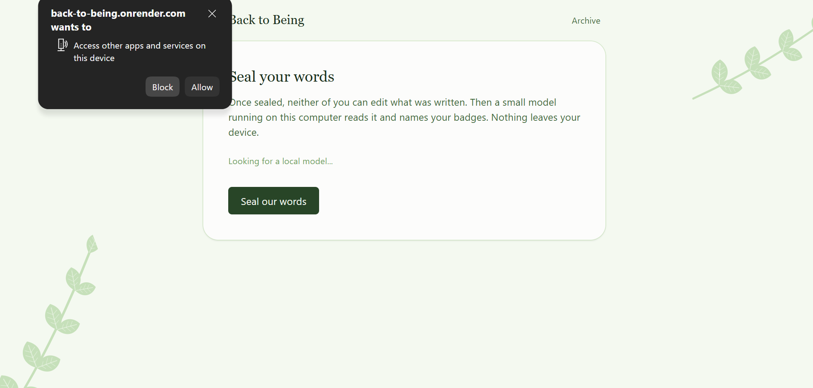
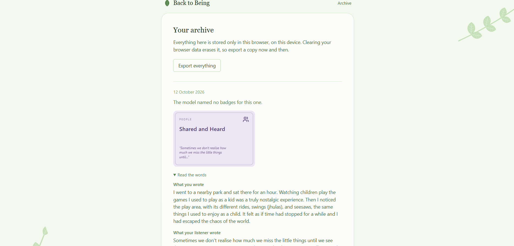

# Back to Being

**Remembered, not recorded.**

A small digital detox ritual: go outside, remember it, write it in your own words, and share it with someone. Only after the human parts are finished does a small open-weight model, running on your own computer, read what you wrote and name your badges.

**Live site (demo page and writing flow):** https://back-to-being.onrender.com


Built for the **Hacktoberfest Open-Source AI Challenge, Week 1 ("Touch Grass")**.



## The ritual (Afterglow)

1. **Go out.** Step outside and notice. No photos, no notes, no AI. Nothing has to be special.
2. **Remember.** Let it settle. Trust what stays with you.
3. **Write.** Describe it in your own words. No rewriting tools, no polishing.
4. **Share.** Tell someone. They write four or five lines of their own about what they noticed.
5. **Seal.** The words are locked. Then a local model names your badges.
6. **Keep it for yourself.** Badges are private keepsakes, not something to post or compare. Come back whenever you are ready (the idea is roughly every 15 days, with no streaks and no guilt).

The screen is the shortest part of the experience. The app has no camera, no photo upload and no audio.

## How the app works

| Step | What happens | Who does it |
|---|---|---|
| Write | A plain text box. No suggestions, no spell-check pressure. Saved on this device as you type. | You |
| Share | The listener reads your words and types a reflection of at least 20 words. Pasting is blocked. | Your listener |
| Seal | Both texts are moved from a draft into a saved ritual. The app offers no way to edit it afterwards. | Plain code |
| Badges | The local model suggests up to 3 badges. Each must quote your exact words. | Open model (Gemma) |
| Check | Any badge whose quote is not really in your writing is thrown away. | Plain code |
| Social Badge | "Shared and Heard" is given for the act of sharing, whatever the listener wrote. | Plain code |
| Archive | See old rituals, export everything as a file, or delete one. | You |

<details>
<summary><b>Screenshots</b> (click to open)</summary>

<br>

**The saved example on the demo page.** Three badges named by the local model, each backed by an exact quote, plus the Social Badge from plain code.



**The browser asks before a hosted page can reach a model on your own computer.**



**My real ritual, saved in the archive.** I didn't allow that permission, so the model couldn't run. No model badges appear, but the Social Badge still does, because plain code gives it.



</details>

## Why open-source AI is the core of this

Journal entries are about as personal as text gets. Running the model locally means:

- **Your words never leave your device.** No server, no account, no analytics. Sending someone's private reflections to a closed API would contradict the whole ritual.
- **It costs nothing to run.** No API key and no per-request bill.
- **It works with no internet** once the model is downloaded.
- **You control the model.** The app picks a Gemma model from whatever Ollama has installed, and you can pull a different one without changing the page.

The model I tested with is **Gemma (`gemma4:e2b`) through Ollama**.

## Designed so you do not have to trust the model

A small model sometimes pads, repeats itself, or quotes words you never wrote. So the model only *suggests*, and plain code decides.

- **The quote checker (`src/lib/verify.ts`)** keeps a badge only if its quote appears in your writing, word for word. It ignores capitals and punctuation, matches whole words only, rejects unknown categories and duplicate quotes, and caps the result at 3 badges.
- **The model's answer is treated as `unknown`** until it has been checked field by field.
- **Everything refused is shown** under "suggestions left out", with the reason.
- **The Social Badge is given by plain code, never by the model.** It marks the act of sharing, not how kind the words were. A test proves that kind and harsh feedback produce the same badge.
- **Sealing never depends on the model.** Your words are saved first. If Ollama is off, you still get a sealed ritual and the Social Badge, and you can ask the model again later.


## Tech stack

- React + TypeScript, built with Vite
- Tailwind CSS v4 (one custom `leaf` palette, hand-drawn SVG leaves)
- React Router
- Vitest
- Ollama + Gemma for the badges
- Browser `localStorage` for data (no backend, no database)
- Hosted as a static site on Render

## Engineering decisions

- **No backend, on purpose.** I started thinking in MERN, then removed the "M" and "E". A server and database would break the promise that nothing leaves your device.
- **One source of truth.** Badge categories live in one list and the type, prompt, schema and colors are all built from it. Add a category and TypeScript tells you where you forgot something.
- **Don't store what you can compute.** The Social Badge is derived from the saved reflection, so there is no second copy to disagree with the first.
- **Badges are React components, not SVG strings.** Text from a model never gets pasted into raw markup.
- **No web fonts from the internet.** Headings use fonts already on the computer, so the page never contacts a third party.
- **Demo mode is a separate page,** not an "is this a demo?" flag spread through the app, so it cannot break the real flow. A test checks that the demo's own badges pass the checker.
- **Tests only where trust lives:** the quote checker, the Social Badge, and the demo data.

## Run it locally

You need Node 20.19+ or 22.12+, and [Ollama](https://ollama.com).

```bash
# 1. get the model
ollama pull gemma4:e2b

# 2. allow the page to talk to Ollama (Windows PowerShell), then restart Ollama
setx OLLAMA_ORIGINS "http://localhost:5173"
# macOS / Linux: OLLAMA_ORIGINS=http://localhost:5173 ollama serve

# 3. run the app
git clone https://github.com/YOUR-USERNAME/back-to-being.git
cd back-to-being
npm install
npm run dev
```

Open http://localhost:5173. Other commands:

```bash
npm test        # run the tests
npm run build   # type-check and build for production
```

The Write and Share pages work without Ollama. Making badges needs it. The `/demo` page shows a saved example and needs nothing installed.

## Project structure

```
src/
  main.tsx, App.tsx          routes
  pages/                     Guide, Write, Share, Reveal, Archive, Demo
  components/                Layout, BadgeCard, ModelStatus, Leaf, LeafSprig
  lib/
    ollama.ts                list models, ask for badges
    prompts.ts               the system prompt and the JSON answer form
    verify.ts (+ test)       the quote checker
    socialBadge.ts (+ test)  the Social Badge, given by plain code
    storage.ts               drafts, sealed rituals, saving badges
    badges.ts                the badge types and the category list
    text.ts, download.ts     small helpers
  data/
    ritual.ts                the ritual's steps and the app's promises
    demo.ts (+ test)         the saved example
```

## Honest limits

- **"Sealed" is a design promise, not encryption.** The app offers no way to edit a sealed ritual, but it is stored as plain text in your browser.
- **Your archive lives in one browser on one device.** Clearing site data erases it. Use "Export everything" to keep a copy.
- **The app cannot prove your listener wrote their own words.** Blocking paste and requiring 20 words are speed bumps. The ritual runs on trust, and the badge is a keepsake, not a certificate.
- **Small models are uneven.** Vague or summary-style writing can produce few or no badges. You can ask again.
- **The hosted site cannot make badges for you** unless your own Ollama is running and allows that address. That is why the demo page exists.

## Hacktoberfest entry

- Challenge: Open-Source AI Challenge, Week 1 (Touch Grass)
- Categories: **Best Use of Gemma** (the local badge model) and **Best Use of Render** (static hosting for the front end)

## AI assistance

I used Claude as a coding tutor and pair while building this: explaining the steps, reviewing my code, and suggesting files that I then typed, ran and committed myself. _Edit this line so it matches how you actually worked._

## Commits after the deadline

The submission deadline is October 11, 2026, 11:59 PM PDT. Any commit made after it will be listed here. _None so far._

## License

[MIT](LICENSE)